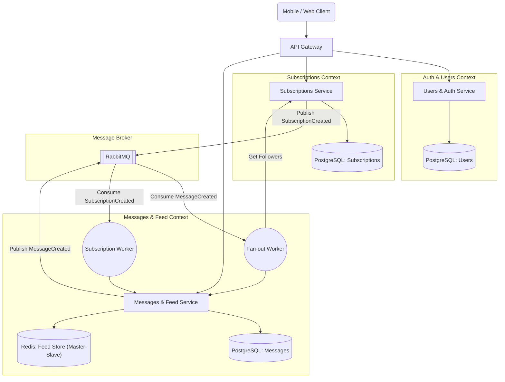

# 🐶 WUPHF

**WUPHF** — это простая социальная сеть. Приложение позволяет пользователям регистрироваться, публиковать короткие сообщения, подписываться друг на друга и мгновенно получать персональную ленту новостей.

 

---

## Модель данных

### User (Пользователь)
Базовая сущность системы, представляющая аккаунт человека.

| Поле | Тип | Описание |
| :--- | :--- | :--- |
| `id` | UUID | Уникальный идентификатор пользователя (Primary Key) |
| `username` | String | Имя пользователя |
| `email` | String | Электронная почта (уникальная, используется для входа) |
| `phone_number` | String | Номер телефона |
| `password` | String | Захэшированный пароль |

### Role (Роль)
Сущность, определяющая права и тип аккаунта в системе (например, `user`, `producer`, `subscriber`, `administrator`).

| Поле | Тип | Описание |
| :--- | :--- | :--- |
| `id` | UUID | Уникальный идентификатор роли (Primary Key) |
| `name` | String | Название роли (уникальное) |

### User_Role (Связь Пользователь-Роль)
Промежуточная (junction) таблица для реализации связи "многие-ко-многим" (Many-to-Many) между пользователями и ролями. Один пользователь может иметь несколько ролей, а одна роль может принадлежать многим пользователям.

| Поле | Тип | Описание |
| :--- | :--- | :--- |
| `user_id` | UUID | Идентификатор пользователя (Foreign Key -> `User.id`) |
| `role_id` | UUID | Идентификатор роли (Foreign Key -> `Role.id`) |

*Примечание: Пара `(user_id, role_id)` образует составной первичный ключ (Composite Primary Key).*

### Message (Сообщение / Твит)
Сущность, представляющая публикацию (пост), созданную пользователем. Данные хранятся в БД сервиса Messages.

| Поле | Тип | Описание |
| :--- | :--- | :--- |
| `id` | UUID | Уникальный идентификатор сообщения (Primary Key) |
| `text` | String | Текст сообщения |
| `author_id` | UUID | Логическая ссылка на автора (ID пользователя из сервиса Users). Строгий Foreign Key отсутствует из-за раздельных БД. |
| `created_at` | Timestamp | Дата и время создания сообщения |

### Subscription (Подписка)
Сущность, представляющая связь между подписчиком и автором. Данные хранятся в БД сервиса Subscriptions.

| Поле | Тип | Описание |
| :--- | :--- | :--- |
| `follower_id` | UUID | Кто подписался (логическая ссылка на `User.id`) |
| `followee_id` | UUID | На кого подписались (логическая ссылка на `User.id`) |
| `created_at` | Timestamp | Дата и время создания подписки |

*Примечание: Пара `(follower_id, followee_id)` образует составной первичный ключ.*

---

## API Контракты (REST)

В микросервисной архитектуре взаимодействие с клиентом будет происходить через API Gateway, который маршрутизирует запросы к соответствующим сервисам. 

**Авторизация:** В системе используются **JWT токены** (с бесконечным сроком жизни). Для эндпоинтов, требующих авторизации (обозначены значком 🔒), клиент должен передавать заголовок:
`Authorization: Bearer <access_token>`

**Обработка ошибок:**
Все сервисы возвращают ошибки в едином стандартизированном формате, например: `{"error": "validation_failed", "message": "Invalid email format"}`. В таблицах ниже эти статусы опущены для краткости, но они обязательны к реализации:
* `400 Bad Request` — ошибка валидации (отсутствует обязательное поле, неверный формат данных, превышен лимит символов в сообщении).
* `401 Unauthorized` — токен отсутствует, невалиден, либо переданы неверные учетные данные при логине.
* `403 Forbidden` — недостаточно прав (попытка изменить или удалить чужой профиль/сообщение).
* `404 Not Found` — ресурс не найден (пользователь удален, сообщение не существует).
* `409 Conflict` — конфликт состояния (пользователь с таким email уже существует, попытка повторной подписки на одного и того же человека).
* `500 Internal Server Error` — непредвиденная ошибка на стороне сервера или базы данных.

### Сервис: Users & Auth (`/api/v1/users`)
Отвечает за регистрацию, аутентификацию (выдачу JWT) и управление пользователями.

| Метод | Эндпоинт | Описание | Параметры/Тело (Request) | Ответ (Response) |
| :--- | :--- | :--- | :--- | :--- |
| **POST** | `/reg` | Регистрация пользователя | `{ username, email, phone_number, password }` | `201 Created`, `{ id, username, email, access_token }` |
| **POST** | `/login` | Вход (аутентификация) | `{ email, password }` | `200 OK`, `{ access_token }` |
| **GET** | `/{id}` | Получение профиля | - | `200 OK`, `{ id, username, roles: [...] }` |
| **PUT** | `/{id}` | 🔒 Обновление профиля | `{ username, phone_number }` | `200 OK`, `{ id, username, ... }` |
| **DELETE**| `/{id}` | 🔒 Удаление пользователя | - | `204 No Content` |

### Сервис: Messages & Feed (`/api/v1/messages`)
Отвечает за управление сообщениями (твитами) и отдачу сформированной персональной ленты сообщений.

| Метод | Эндпоинт | Описание | Параметры/Тело (Request) | Ответ (Response) |
| :--- | :--- | :--- | :--- | :--- |
| **POST** | `/` | 🔒 Создание сообщения | `{ text }` | `201 Created`, `{ id, text, created_at, author_id }` |
| **GET** | `/{id}` | Получение сообщения | - | `200 OK`, `{ id, text, created_at, author_id }` |
| **GET** | `/user/{author_id}`| Получение всех сообщений конкретного автора | Query: `?limit=20` | `200 OK`, `[{ id, text, ... }, ...]` |
| **GET** | `/feed` | 🔒 Получение ленты сообщений авторизованного пользователя | Query: `?limit=20` | `200 OK`, `[{ id, text, author_id, ... }]` |
| **DELETE**| `/{id}` | 🔒 Удаление (автор/admin)| - | `204 No Content` |

### Сервис: Subscriptions (`/api/v1/subscriptions`)
Отвечает за подписки пользователей друг на друга.

| Метод | Эндпоинт | Описание | Параметры (Request) | Ответ (Response) |
| :--- | :--- | :--- | :--- | :--- |
| **POST** | `/{followee_id}` | 🔒 Подписаться на пользователя | - | `201 Created` |
| **DELETE**| `/{followee_id}` | 🔒 Отписаться от пользователя | - | `204 No Content` |
| **GET** | `/{id}/followers` | Получить подписчиков (кто читает пользователя) | Query: `?limit=50` | `200 OK`, `[{ user_id, ... }]` |
| **GET** | `/{id}/following` | Получить подписки (кого читает пользователь) | Query: `?limit=50` | `200 OK`, `[{ user_id, ... }]` |

---

## Архитектура развертывания (Контейнеры)

Ниже представлена схема взаимодействия контейнеров в системе:

---

## Архитектура Ленты (Fan-out on Write)

Для обеспечения мгновенной отдачи ленты при высокой нагрузке используется **Push-модель**. Лента каждого пользователя предвычисляется заранее и хранится в быстром In-Memory хранилище (Redis).

> **Отказоустойчивость Redis:**
> Redis запускается в отдельном контейнере и используется как неэфемерное хранилище. Для предотвращения потери данных включены механизмы персистентности (AOF/RDB) и Master-Slave репликация.

### 1. Хранилище (Redis)
Для каждого пользователя создается структура **Sorted Set** (упорядоченное множество).
* **Ключ:** `feed:{user_id}`
* **Значение:** `message_id`
* **Score:** `created_at` (Timestamp сообщения, используется для сортировки)

### 2. Процесс публикации сообщения (Worker Flow)
1. **Создание:** Автор (Producer) публикует сообщение через эндпоинт `POST /api/v1/messages`.
2. **Событие:** Сервис Messages сохраняет твит в свою БД и отправляет событие `MessageCreated` в брокер сообщений (RabbitMQ).
3. **Fan-out Worker (с пагинацией):** 
   * Отдельный асинхронный воркер читает событие `MessageCreated`.
   * Чтобы избежать перегрузки памяти (OOM) при обработке авторов с миллионами подписчиков, воркер запрашивает БД Subscriptions порциями (например, `LIMIT 10000 OFFSET X`).
   * Для каждого полученного чанка (chunk) подписчиков воркер выполняет пакетную запись (Pipeline/Batch) в Redis.
   * *Команда Redis:* `ZADD feed:{follower_id} <timestamp> <message_id>`
   * Процесс повторяется, пока не будут обработаны все подписчики автора.

### 3. Чтение ленты (`GET /api/v1/messages/feed`)
1. Запрос от клиента попадает в сервис Messages.
2. Сервис читает предвычисленную ленту пользователя из Redis, забирая N свежих ID сообщений:
   * *Команда Redis:* `ZREVRANGE feed:{user_id} 0 20`
3. Получив список `message_id`, сервис достает из своей БД (или кэша) полные тексты этих сообщений.
4. Готовая лента с текстами и авторами возвращается клиенту.

### 4. Реакция на новую подписку (Follow)
Когда пользователь `A` нажимает "Подписаться" на автора `B`:
1. **Событие:** Создается запись в БД сервиса Subscriptions, и сервис отправляет событие `SubscriptionCreated(follower_id=A, followee_id=B)` в брокер сообщений.
2. **Subscription Worker (в сервисе Messages):** Асинхронно читает это событие из брокера.
3. Воркер делает запрос в БД Messages: *"Получить N последних сообщений автора B"*.
4. Добавляет их `message_id` в Redis по ключу `feed:{user_A}`, чтобы лента подписчика обновилась мгновенно историей нового автора.